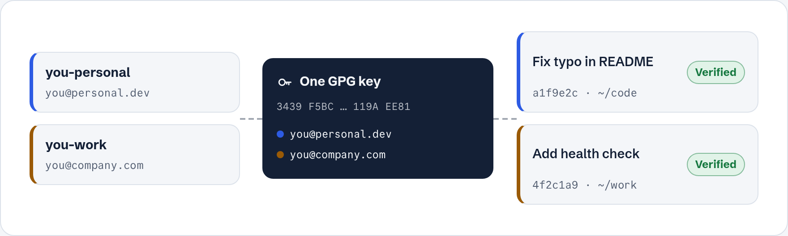

<div align="center">

# Multiple GitHub Accounts on One Machine, Every Commit Verified

**Personal and work GitHub on the same laptop.** Switch accounts with one command, sign every commit with one GPG key,
and get the green **Verified** badge on both accounts. About 15 minutes, by hand, no extra tools.

[](https://md8-habibullah.github.io/multiple-github-accounts-gpg-verified/)
[](https://cli.github.com)
[](https://gnupg.org)
[](https://git-scm.com)
[](docs/install.md)
[](LICENSE)

[**Read it as a website**](https://md8-habibullah.github.io/multiple-github-accounts-gpg-verified/) ·
[Quick setup](#quick-setup) ·
[Troubleshooting](docs/troubleshooting.md) ·
[FAQ](docs/faq.md) ·
[Cheat sheet](docs/cheatsheet.md)


</div>

---

## Why this guide

The usual answer to "two GitHub accounts on one computer" is SSH host aliases: a key per account, a `~/.ssh/config` full of
`Host github-work` entries, and every clone URL rewritten to match. It works until you paste a normal URL, push as the wrong
person, or commit to a work repo with your personal email.

This setup removes all of that:

- **One command to switch.** The GitHub CLI holds both logins; `gh auth switch` picks who pushes.
- **Normal URLs.** Clone and push with the URLs GitHub gives you. No aliases, no rewritten remotes.
- **The right email by folder.** Repos in `~/work/` use your work email automatically, everything else your personal one.
- **Verified everywhere.** One GPG key carries both emails, so every commit and tag is signed on both accounts.

<!-- site:start -->

## What you end up with

<picture>
  <source media="(prefers-color-scheme: dark)" srcset="docs/images/overview-dark.png">
  
</picture>

- **Both accounts logged in** with the GitHub CLI (`gh`). You switch with one command and never paste tokens.
- **One GPG key** that holds both of your emails, so commits are signed for either account.
- **Verified** next to every commit you push, on both accounts.
- **The right email picked automatically**: work repos use your work email, everything else uses your personal one.

## Before you start

| You need | Where |
|---|---|
| Two GitHub accounts, e.g. `you-personal` and `you-work` | |
| One email per account, **verified** on that account | [github.com/settings/emails](https://github.com/settings/emails) |
| `git`, `gh` (2.40+) and `gpg` installed | [install commands](docs/install.md) (Linux, macOS, Windows) |
| About 15 minutes | |

> **Tip:** use two browser profiles (one per account). Logging in each account becomes painless, because GitHub approves a login for whichever account is signed in **in the browser**.

## Quick setup

### 1. Log in to both accounts

`gh` keeps several accounts side by side. Run the login once per account, with the browser signed in as that account.

```bash
gh auth login        # personal (browser signed in as personal)
gh auth login        # work     (browser signed in as work)
gh auth setup-git    # lets git push/pull through gh, no passwords
gh auth status       # should list both accounts
```

Answers to pick: `GitHub.com` → `HTTPS` → `Yes` → `Login with a web browser`. Then paste the code shown in the terminal on the page that opens.
Full walkthrough: [Log in to two GitHub accounts](docs/1-login.md)

### 2. Make one GPG key with both emails

The key is your digital signature. One key can carry several emails, so add both.

```bash
gpg --full-generate-key                                 # personal email, leave Comment EMPTY
gpg --list-secret-keys --keyid-format=long              # copy the long key ID (40 characters)
gpg --quick-add-uid <KEY_ID> "Your Name <you@company.com>"
gpg --check-trustdb                                     # marks the new email as yours
```

Expiry: choose `0` (never) or `2y`. Don't type a huge value like `100y`, gpg rejects it.
Full walkthrough: [Create one GPG key with both emails](docs/2-gpg-key.md)

### 3. Put the key on both accounts

GitHub needs the **public** half of the key to check your signatures.

```bash
gpg --armor --export <KEY_ID> > key.asc
```

On **each** account, open [github.com/settings/gpg/new](https://github.com/settings/gpg/new) and paste the whole file.
Full walkthrough, and the terminal way with `gh`: [Add the GPG key to GitHub](docs/3-upload-key.md)

### 4. Tell Git who you are and to sign everything

```bash
git config --global user.name  "Your Name"
git config --global user.email "you@personal.dev"
git config --global user.signingkey <KEY_ID>
git config --global commit.gpgsign true
git config --global tag.gpgsign true
```

Also add `export GPG_TTY=$(tty)` to `~/.bashrc` / `~/.zshrc` (fish: `set -gx GPG_TTY (tty)`) so gpg can ask for your passphrase.
Full walkthrough: [Make Git sign every commit](docs/4-git-setup.md)

### 5. Work email in work folders (optional, recommended)

Put work repos in `~/work/` and Git uses your work email there by itself.

```bash
mkdir -p ~/work
printf '[user]\n    email = you@company.com\n' > ~/.gitconfig-work
git config --global includeIf."gitdir:~/work/".path ~/.gitconfig-work
```

Full walkthrough: [Work email by folder](docs/5-work-folder.md)

### 6. Back up your key now

If your laptop dies and you have no backup, the key is gone for good. It takes 1 minute:

```bash
gpg --armor --export-secret-keys <KEY_ID> > private-key-BACKUP.asc
```

Copy it to a USB stick or password manager, **never** to a repo or cloud chat.
Full guide (restore, renew, lost key): [Back up your GPG key](docs/backup.md)

## Every day

```bash
gh auth switch          # choose the account that owns the repo you'll push to
git commit -m "..."     # signed automatically, email picked by folder
git push
```

Then check the commit on GitHub: it should show **Verified**.
More: [Switch accounts and check Verified commits](docs/6-daily-use.md)

## Recommended settings and tips

These aren't required, but they save most developers trouble later.

### Check what your device already set

Some systems, distros or tools put their own Git defaults in `/etc/gitconfig` or `~/.gitconfig`. See everything that's active and **which file it comes from**:

```bash
git config --list --show-origin
git config --show-origin pull.rebase     # check one setting
```

A value set by the system can be overridden with `--global`.

### Settings most developers want

| Setting | Command | Why |
|---|---|---|
| Merge on pull (no rebase) | `git config --global pull.rebase false` | Some devices or tools set this to `true`. Then `git pull` rewrites your local commits, which surprises most people. `false` is the safe, normal default. Use `true` only if your team wants rebase. |
| Branch name `main` | `git config --global init.defaultBranch main` | New repos start on `main`, same as GitHub |
| Easy first push | `git config --global push.autoSetupRemote true` | `git push` on a new branch just works, with no `--set-upstream` |
| Clean old branches | `git config --global fetch.prune true` | Removes deleted remote branches on fetch |
| Sign tags too | `git config --global tag.gpgsign true` | Releases show Verified as well. Tags then need a message: `git tag -m "v1.0.0" v1.0.0` |
| Line endings, Linux/macOS | `git config --global core.autocrlf input` | Avoids "every line changed" diffs |
| Line endings, Windows | `git config --global core.autocrlf true` | Same, for Windows |

### Privacy

- **Hide your real email.** Each account has a noreply address (e.g. `12345+you@users.noreply.github.com`) on [settings/emails](https://github.com/settings/emails). You can use it as the commit email and add it to your GPG key too. Your real email then never appears in public history.
- On the same page, turn on **Keep my email addresses private** and **Block command line pushes that expose my email**.

### Security

- **Turn on 2FA** for both accounts: [github.com/settings/security](https://github.com/settings/security).
- **Use a passphrase** on the GPG key and keep it in a password manager.
- **Never commit key files.** Add this to your global gitignore:

  ```bash
  printf '*.asc\n*.gpg\n*.rev\n' >> ~/.gitignore_global
  git config --global core.excludesFile ~/.gitignore_global
  ```

- **Don't store tokens in plain text.** `gh auth setup-git` already handles logins. Avoid `git config credential.helper store`.
- **Flag fakes.** At [settings/keys](https://github.com/settings/keys), turn on **Flag unsigned commits as unverified**, so anyone faking commits as you shows up.

### Good habits

- Run `gh auth status` when unsure which account is active.
- Run `git config user.email` inside a repo before the first commit, to see which email it will use.
- If you add an email to the key later, **re-upload** the key to GitHub.
- Set a calendar reminder if your key expires. Renewing takes one command ([backup.md](docs/backup.md#renew-before-it-expires)).

<!-- site:end -->

## FAQ

**Can I use two GitHub accounts on one computer?**
Yes. `gh` 2.40+ keeps both logged in, `gh auth switch` picks who pushes, and Git picks the email by folder.

**Do I need SSH keys or `~/.ssh/config` host aliases?**
No. Everything runs over HTTPS through `gh`, with normal clone URLs.

**Can the same GPG key be on two GitHub accounts?**
Yes, GitHub accepts it (tested October 2026). Each account verifies the emails verified on it.

**Why does my commit say Unverified?**
The commit email must be in your key **and** verified on the account holding the key. [Check all three rules](docs/troubleshooting.md#commit-shows-unverified-on-github).

**`error: gpg failed to sign the data`?**
Usually the missing `GPG_TTY` line. [Fix it in a minute](docs/troubleshooting.md#error-gpg-failed-to-sign-the-data).

More answers, including SSH signing, VS Code, Windows and 3+ accounts: [docs/faq.md](docs/faq.md)

## All pages

| Page | What's inside |
|---|---|
| [Install](docs/install.md) | Install git, gh and gpg on Linux, macOS and Windows |
| [1. Log in](docs/1-login.md) | Log in to both accounts, switch between them |
| [2. GPG key](docs/2-gpg-key.md) | Create the key, add emails, fix mistakes |
| [3. Upload the key](docs/3-upload-key.md) | Put the key on GitHub (browser or gh) |
| [4. Git settings](docs/4-git-setup.md) | Git identity, signing, passphrase prompt, signed tags |
| [5. Work folder](docs/5-work-folder.md) | Automatic work email in `~/work/` |
| [Daily use](docs/6-daily-use.md) | Push to the right account, check signatures |
| [Backup](docs/backup.md) | Back up, restore, renew, lost key |
| [Troubleshooting](docs/troubleshooting.md) | Every common error message and its fix |
| [FAQ](docs/faq.md) | SSH vs HTTPS, SSH signing, IDEs, Windows, more accounts |
| [Cheat sheet](docs/cheatsheet.md) | Every command on one page |
| [How it works](docs/how-it-works.md) | Diagrams, only if you're curious |

## Contributing

Found a step that didn't match your system, or an error that isn't covered? [Open an issue](https://github.com/md8-habibullah/multiple-github-accounts-gpg-verified/issues/new/choose) or a pull request. See [CONTRIBUTING.md](CONTRIBUTING.md).

If this saved you an afternoon of SSH config, a ⭐ helps other developers find it.

---

<div align="center">

Written by **MD. Habibullah Sharif** · [habibullah.dev](https://habibullah.dev) · [github.com/md8-habibullah](https://github.com/md8-habibullah) · [dev.to/md8_habibullah](https://dev.to/md8_habibullah)

MIT licensed. Not affiliated with GitHub.

</div>
