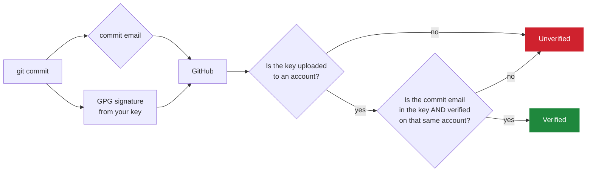
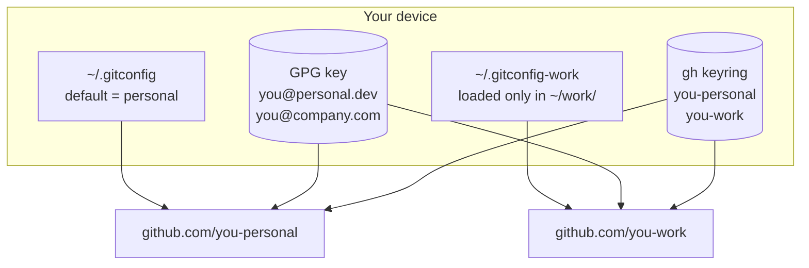
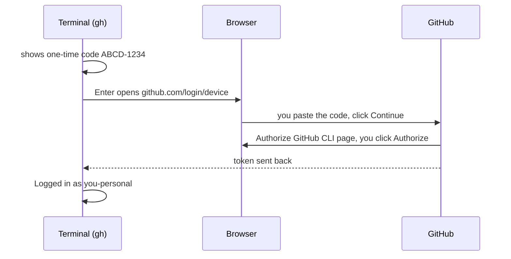
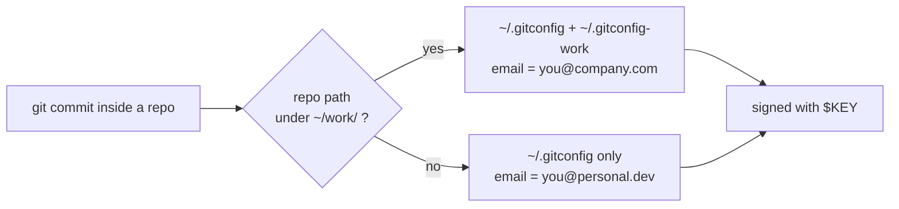

<div align="center">

# Multiple GitHub Accounts on One Device
### with GitHub CLI and GPG-verified commits

Run a **personal** and a **work** GitHub account side by side on one machine.
Every commit is signed with GPG and shows the green **Verified** badge, done by hand, step by step.


</div>

---

## Contents

1. [How it works](#1-how-it-works)
2. [Plan your setup](#2-plan-your-setup)
3. [Install the tools](#3-install-the-tools)
4. [Log in to both accounts with gh](#4-log-in-to-both-accounts-with-gh)
5. [Add and verify your emails on GitHub](#5-add-and-verify-your-emails-on-github)
6. [Create a GPG key](#6-create-a-gpg-key)
7. [Add more emails to the same key](#7-add-more-emails-to-the-same-key)
8. [Upload the public key to GitHub](#8-upload-the-public-key-to-github)
9. [Global Git configuration](#9-global-git-configuration)
10. [Per-folder identity (personal vs work)](#10-per-folder-identity-personal-vs-work)
11. [Daily workflow and verification](#11-daily-workflow-and-verification)
12. [If GitHub refuses the same key twice](#12-if-github-refuses-the-same-key-twice)
13. [Troubleshooting](#13-troubleshooting)
14. [Command cheat sheet](#14-command-cheat-sheet)

---

## 1. How it works

Three separate things have to line up for a commit to show **Verified**:

| Piece | What it does | Where it lives |
|---|---|---|
| **gh CLI login** | Proves *who you are* when you push and pull (HTTPS). | `gh auth` keyring |
| **Git identity** | The name and email written *into* each commit. | `~/.gitconfig` |
| **GPG signature** | Cryptographic proof that *you* made the commit. | `~/.gnupg` |



> **The golden rule:** commit email = an email inside your GPG key = a verified email on the GitHub account that holds that key.

---

## 2. Plan your setup

Fill this table in **before** you start. This guide uses these example values. Replace them with your own everywhere.

| | Personal | Work |
|---|---|---|
| GitHub username | `you-personal` | `you-work` |
| Commit email | `you@personal.dev` | `you@company.com` |
| Folder for its repos | everything else | `~/work/` |
| Signing key | one key with **both** emails ([section 6](#6-create-a-gpg-key)) | the same key ([section 12](#12-if-github-refuses-the-same-key-twice) has a fallback) |



---

## 3. Install the tools

| OS | Command |
|---|---|
| Arch / CachyOS / Manjaro | `sudo pacman -S git github-cli gnupg` |
| Debian / Ubuntu | `sudo apt install git gh gnupg` (for the newest `gh`, see [cli.github.com](https://cli.github.com)) |
| Fedora | `sudo dnf install git gh gnupg2` |
| macOS (Homebrew) | `brew install git gh gnupg pinentry-mac` |

Check the versions. Multiple accounts in `gh` need **gh 2.40 or newer**.

```bash
git --version
gh --version
gpg --version
```

---

## 4. Log in to both accounts with gh

### 4.1 First account (personal)

> **Before you start:** in your browser, sign in to GitHub as the **personal** account.
> The browser approves the login for whichever account is signed in **there**.

```bash
gh auth login
```

Answer the prompts like this:

```text
? Where do you use GitHub?                         GitHub.com
? What is your preferred protocol for Git operations on this host?   HTTPS
? Authenticate Git with your GitHub credentials?   Yes
? How would you like to authenticate GitHub CLI?   Login with a web browser

! First copy your one-time code: ABCD-1234
Press Enter to open https://github.com/login/device in your browser...
```

What happens next:



1. Press **Enter**. Your browser opens **https://github.com/login/device**.
2. Paste the 8-character code (gh usually copies it to your clipboard already) and click **Continue**.
3. Click **Authorize github**.
4. The browser says *"Congratulations, you're all set!"* and the terminal prints `Logged in as you-personal`.

> If the browser does not open (for example `exec: "firefox": executable file not found`), your `$BROWSER` variable points to a browser that isn't installed. Open the link by hand, or fix it permanently:
> `gh config set browser <your-browser-command>`

### 4.2 Second account (work)

1. In the browser, **sign out** of the personal account and sign in as **work**. A private window also works: copy the link into it by hand.
2. Run the same command again. `gh` **adds** the account instead of replacing the first one:

```bash
gh auth login
```

### 4.3 Check and switch

```bash
gh auth status
```

```text
github.com
  ✓ Logged in to github.com account you-work (keyring)
  - Active account: true
  - Git operations protocol: https
  - Token scopes: 'gist', 'read:org', 'repo', 'workflow'

  ✓ Logged in to github.com account you-personal (keyring)
  - Active account: false
  ...
```

The **active account** is the one `gh` (and `git push` over HTTPS) uses right now.

```bash
gh auth switch                    # pick from a list
gh auth switch -u you-personal    # switch directly
gh api user --jq .login           # prints the active account
```

### 4.4 Let Git use gh for HTTPS

```bash
gh auth setup-git
```

This adds `gh auth git-credential` as the credential helper in `~/.gitconfig`, so `git push` / `git pull` use the active gh account. You never type tokens.

---

## 5. Add and verify your emails on GitHub

For **each** account, open **https://github.com/settings/emails** and:

1. Type the email in **Add email address**, then click **Add**.
2. Open the inbox and click the verification link. The email now shows **Verified**.
3. (Optional) Turn on **Keep my email addresses private** and **Block command line pushes that expose my email**.

| Account | Emails that must be verified there |
|---|---|
| `you-personal` | `you@personal.dev` |
| `you-work` | `you@company.com` |

> **Private-email option:** GitHub gives each account a noreply address like
> `12345678+you-work@users.noreply.github.com` (shown on the same page).
> You can use it as the commit email **and** as an email in your GPG key. It counts as verified automatically, and your real address never appears in public commits.

---

## 6. Create a GPG key

```bash
gpg --full-generate-key
```

Walk through the prompts:

| Prompt | Type this | Why |
|---|---|---|
| `Please select what kind of key you want` | `9` or just Enter | ECC (sign and encrypt), modern default |
| `Please select which elliptic curve you want` | `1` or just Enter | Curve 25519, supported by GitHub |
| `Key is valid for? (0)` | `0` or `2y` | `0` = never expires. **Don't use `100y`**: it overflows to a date in the past and is rejected as `invalid value`. |
| `Is this correct? (y/N)` | `y` | |
| `Real name:` | `Your Name` | |
| `Email address:` | `you@personal.dev` | your **first** (primary) email |
| `Comment:` | **leave empty, press Enter** | Typing your name/email here again gives a messy ID like `Name (Real name: Name...) <email>` |
| `Change (N)ame, (C)omment, (E)mail or (O)kay/(Q)uit?` | `O` | |
| Passphrase window | a strong passphrase | protects the key if your disk is stolen |

You should see:

```text
public and secret key created and signed.

pub   ed25519 2026-10-16 [SC]
      AFB70B6C70AAAD41E4C26B7C21C21FB0B1A939BF
uid                      Your Name <you@personal.dev>
sub   cv25519 2026-10-16 [E]
```

The long hex line is the **fingerprint** (your key ID). Print it again any time:

```bash
gpg --list-secret-keys --keyid-format=long
```

```text
sec   ed25519/21C21FB0B1A939BF 2026-10-16 [SC]
      AFB70B6C70AAAD41E4C26B7C21C21FB0B1A939BF
uid                 [ultimate] Your Name <you@personal.dev>
ssb   cv25519/308C6FDD93793AE5 2026-10-16 [E]
```

Save it in a shell variable for the next steps (bash/zsh):

```bash
KEY=AFB70B6C70AAAD41E4C26B7C21C21FB0B1A939BF   # use YOUR fingerprint
```

Fish: `set KEY AFB70B6C70AAAD41E4C26B7C21C21FB0B1A939BF`

---

## 7. Add more emails to the same key

One GPG key can carry several identities (**UIDs**). Add one per email you commit with.

### 7.1 Add an email

```bash
gpg --quick-add-uid $KEY "Your Name <you@company.com>"
```

Enter your passphrase when asked. Repeat for each extra email, including a noreply address if you use one.

### 7.2 Choose the primary email

```bash
gpg --quick-set-primary-uid $KEY "Your Name <you@personal.dev>"
```

### 7.3 Remove a wrong email (only if you made a mistake)

This uses gpg's interactive editor:

```text
$ gpg --edit-key $KEY

gpg> list
[ultimate] (1). Your Name <you@personal.dev>
[ultimate] (2)  Your Name (Real name: oops) <you@personal.dev>
[ultimate] (3)  Your Name <you@company.com>

gpg> uid 2            # select the wrong one (a * appears next to it)
gpg> deluid
Really remove this user ID? (y/N) y
gpg> save
```

> Only **delete** a UID if the key was never uploaded anywhere. If it was already shared, use `revuid` instead of `deluid` so the change spreads properly.

### 7.4 Check

```bash
gpg --list-keys --keyid-format=long $KEY
```

```text
pub   ed25519/21C21FB0B1A939BF 2026-10-16 [SC]
uid                 [ultimate] Your Name <you@personal.dev>
uid                 [ultimate] Your Name <you@company.com>
sub   cv25519/308C6FDD93793AE5 2026-10-16 [E]
```

> Every time you add or remove an email, **export and upload the key again** ([section 8](#8-upload-the-public-key-to-github)). GitHub only knows the emails that were in the key when you uploaded it.

---

## 8. Upload the public key to GitHub

### 8.1 Export the public key

```bash
gpg --armor --export $KEY > my-gpg-public.asc
```

The file starts with `-----BEGIN PGP PUBLIC KEY BLOCK-----`. This is the **public** half and is safe to share.
Never share the output of `gpg --export-secret-keys`.

### 8.2 Option A: with gh (do it for each account)

Uploading keys needs one extra permission (`write:gpg_key`), which a normal login doesn't include. `gh auth refresh` asks for it with the same code + browser flow as in [section 4](#4-log-in-to-both-accounts-with-gh). Make sure the browser is signed in as the **matching** account.

```bash
# personal
gh auth switch -u you-personal
gh auth refresh -h github.com -s write:gpg_key
gh gpg-key add my-gpg-public.asc --title "My Laptop"

# work
gh auth switch -u you-work
gh auth refresh -h github.com -s write:gpg_key
gh gpg-key add my-gpg-public.asc --title "My Laptop"

# back to your usual account
gh auth switch -u you-personal
gh gpg-key list
```

### 8.3 Option B: in the browser

1. Open **https://github.com/settings/keys**.
2. Click **New GPG key**.
3. Title: `My Laptop`. Key: paste the **entire** contents of `my-gpg-public.asc`, including the BEGIN/END lines.
4. Click **Add GPG key** and confirm with your password or 2FA.

GitHub then lists the key with its **Email address** entries. Each email shows as verified or unverified for **that** account.

---

## 9. Global Git configuration

These are the defaults. Personal is the default everywhere.

```bash
git config --global user.name  "Your Name"
git config --global user.email "you@personal.dev"
git config --global user.signingkey $KEY
git config --global commit.gpgsign true
git config --global tag.gpgsign true
git config --global init.defaultBranch main
git config --global pull.rebase false
```

So that gpg can ask for your passphrase inside the terminal, add this line to your shell config:

| Shell | File | Line |
|---|---|---|
| bash | `~/.bashrc` | `export GPG_TTY=$(tty)` |
| zsh | `~/.zshrc` | `export GPG_TTY=$(tty)` |
| fish | `~/.config/fish/conf.d/gpg.fish` | `set -gx GPG_TTY (tty)` |

macOS only: `echo "pinentry-program $(which pinentry-mac)" >> ~/.gnupg/gpg-agent.conf`, then run `gpgconf --kill gpg-agent`.

Your `~/.gitconfig` now looks like this:

```ini
[user]
    name = Your Name
    email = you@personal.dev
    signingkey = AFB70B6C70AAAD41E4C26B7C21C21FB0B1A939BF
[commit]
    gpgsign = true
[tag]
    gpgsign = true
[init]
    defaultBranch = main
[pull]
    rebase = false
[credential "https://github.com"]
    helper =
    helper = !/usr/bin/gh auth git-credential
```

---

## 10. Per-folder identity (personal vs work)

Git can load extra settings only for repos inside a certain folder. Use this to make the **work** email automatic.

### 10.1 Create the work folder and its config

```bash
mkdir -p ~/work
```

Create **`~/.gitconfig-work`**:

```ini
[user]
    email = you@company.com
    # signingkey = <work fingerprint>   # only if you use a separate work key (section 12)
```

### 10.2 Tell the global config to load it

Add this at the **end** of `~/.gitconfig`:

```ini
[includeIf "gitdir:~/work/"]
    path = ~/.gitconfig-work
```

> The trailing `/` in `gitdir:~/work/` matters: it means "any repo inside this folder".
> It only applies **inside a Git repo**, not in the empty folder itself.



### 10.3 Test it

```bash
cd ~/work && git init test-repo && cd test-repo
git config --show-origin user.email
# file:/home/you/.gitconfig-work   you@company.com

cd ~ && git init /tmp/personal-test && cd /tmp/personal-test
git config --show-origin user.email
# file:/home/you/.gitconfig        you@personal.dev
```

---

## 11. Daily workflow and verification

### 11.1 Clone, commit, push

```bash
# work repo
gh auth switch -u you-work
cd ~/work
gh repo clone your-company/project
cd project
git commit -m "feat: something"     # signed automatically, work email
git push

# personal repo
gh auth switch -u you-personal
cd ~/projects
gh repo clone you-personal/side-project
```

> **Push and pull use the active gh account.** Run `gh auth status` if unsure, and `gh auth switch` before pushing to the other account's repos.
> The commit **email and signature** are chosen by the folder ([section 10](#10-per-folder-identity-personal-vs-work)), so they are always right. Only the push login needs the switch.

### 11.2 Verify locally

```bash
git log --show-signature -1
```

```text
commit 3f2a9c1...
gpg: Signature made Fri 16 Oct 2026 08:30:00 PM
gpg:                using EDDSA key AFB70B6C70AAAD41E4C26B7C21C21FB0B1A939BF
gpg: Good signature from "Your Name <you@company.com>" [ultimate]
gpg:                 aka "Your Name <you@personal.dev>" [ultimate]
Author: Your Name <you@company.com>
```

Other useful checks:

```bash
git verify-commit HEAD             # exit 0 = good signature
git log --pretty='%h %G? %ae %s'   # G = good, N = not signed, B = bad
```

### 11.3 Verify on GitHub

Open the repo's commit list: `https://github.com/<owner>/<repo>/commits`. Each signed commit shows a **Verified** label. Click it to see the key ID and the email it matched.

### 11.4 (Optional) Vigilant mode

**https://github.com/settings/keys**, then turn on **Flag unsigned commits as unverified**. After that, any unsigned commit made in your name shows as **Unverified**, so nobody can quietly pretend to be you.

---

## 12. If GitHub refuses the same key twice

GitHub can refuse a key that is already on another account (`Key is already in use`). If that happens, give each account **its own** key:

```bash
gpg --full-generate-key        # second key, email = you@company.com
gpg --list-secret-keys --keyid-format=long
WORK_KEY=<new fingerprint>
gpg --armor --export $WORK_KEY > work-gpg-public.asc
gh auth switch -u you-work
gh gpg-key add work-gpg-public.asc --title "My Laptop (work)"
```

Then put the work key in `~/.gitconfig-work`:

```ini
[user]
    email = you@company.com
    signingkey = <WORK_KEY fingerprint>
```

Optionally remove `you@company.com` from the personal key so each key matches exactly one account (see 7.3).

---

## 13. Troubleshooting

| Symptom | Cause | Fix |
|---|---|---|
| `error: gpg failed to sign the data` | gpg can't show the passphrase prompt | Set `GPG_TTY` ([section 9](#9-global-git-configuration)), then `gpgconf --kill gpg-agent`, then try `echo test \| gpg --clearsign` |
| Commit shows **Unverified** on GitHub | Commit email is not in the key, or not verified on the account holding the key | Compare `git log -1 --format=%ae` with `gpg -k` and **github.com/settings/emails** |
| Key on GitHub lists an email as *Unverified* | Email not yet verified on that account | Verify it at **settings/emails**, nothing else needed |
| Added an email to the key, still Unverified | GitHub has the old copy of the key | Delete the key on GitHub, export again, upload again |
| `Permission denied` / `403` on push | Wrong active gh account | `gh auth status`, then `gh auth switch -u <owner>` |
| `HTTP 404: Not Found (... /user/gpg_keys)` / missing scope | Token lacks `write:gpg_key` | `gh auth refresh -h github.com -s write:gpg_key` |
| Browser doesn't open on `gh auth login` | `$BROWSER` points to a missing program | `gh config set browser <browser-command>`, or open the link by hand |
| Login went to the wrong account | Browser was signed in as the other account | Sign out in the browser (or use a private window), then `gh auth login` again |
| `invalid value` for key expiry | Very large values like `100y` overflow | Use `0` (never) or something like `2y` |
| Wrong email in commits | Repo is outside `~/work/` or the `includeIf` path is wrong | `git config --show-origin user.email` |

---

## 14. Command cheat sheet

<details>
<summary><b>gh accounts</b></summary>

```bash
gh auth login                         # add an account
gh auth status                        # list accounts + active one
gh auth switch -u <user>              # change active account
gh auth logout -u <user>              # remove an account
gh auth setup-git                     # let git use gh for HTTPS
gh auth refresh -s write:gpg_key      # allow key uploads
```
</details>

<details>
<summary><b>GPG key</b></summary>

```bash
gpg --full-generate-key                           # create
gpg --list-secret-keys --keyid-format=long        # show keys
gpg --quick-add-uid $KEY "Name <email>"           # add email
gpg --quick-set-primary-uid $KEY "Name <email>"   # primary email
gpg --edit-key $KEY                               # list / uid N / deluid / save
gpg --armor --export $KEY > public.asc            # export public key
gh gpg-key add public.asc --title "Laptop"        # upload
gh gpg-key list                                   # keys on active account
```
</details>

<details>
<summary><b>Git identity and signing</b></summary>

```bash
git config --global user.signingkey $KEY
git config --global commit.gpgsign true
git config --global tag.gpgsign true
git config --show-origin user.email      # which email applies here, and why
git log --show-signature -1              # check last commit's signature
git verify-commit HEAD
```
</details>

<details>
<summary><b>Back up your key (do this once, keep it offline)</b></summary>

```bash
gpg --armor --export-secret-keys $KEY > private-key-BACKUP.asc   # keep secret, offline
gpg --armor --export $KEY > public-key.asc
# restore on a new machine:
gpg --import private-key-BACKUP.asc
```
The revocation certificate is in `~/.gnupg/openpgp-revocs.d/`. Store it with the backup.
</details>

---

<div align="center">

Written by **Habibullah**
[habibullah.dev](https://habibullah.dev) · [github.com/md8-habibullah](https://github.com/md8-habibullah)

</div>
