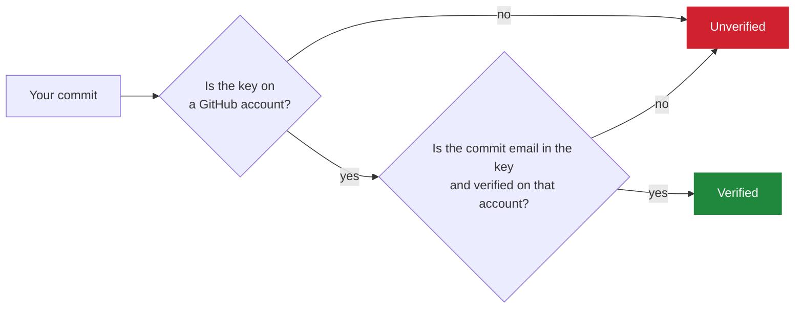
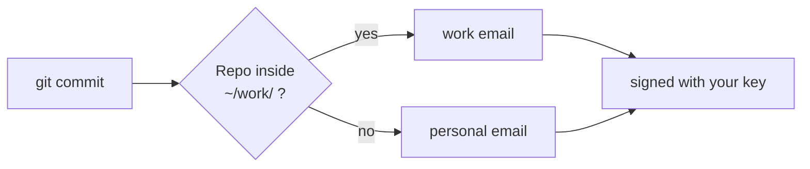
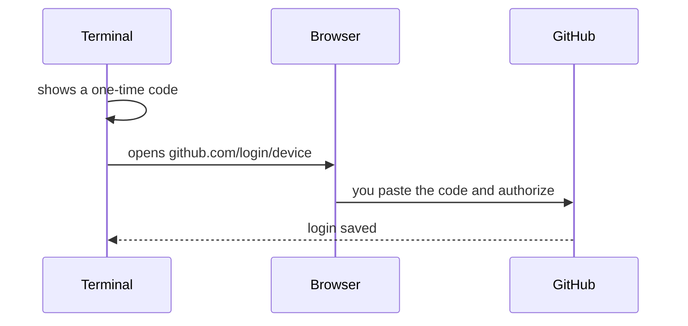

[Home](../README.md) · How it works (optional)

# How it works

You don't need this page to follow the setup. It's here if you're curious.

## Three separate pieces

| Piece | Job | Stored in |
|---|---|---|
| gh login | Lets you push and pull | gh's keyring |
| Git email | Written into every commit | `~/.gitconfig` |
| GPG signature | Proves the commit is really yours | `~/.gnupg` |

## When does GitHub say Verified?

## Which email does Git use?

## The login flow

That's why the browser must be signed in to the right account: GitHub approves the login for whoever is signed in **there**.

---

[Home](../README.md)
