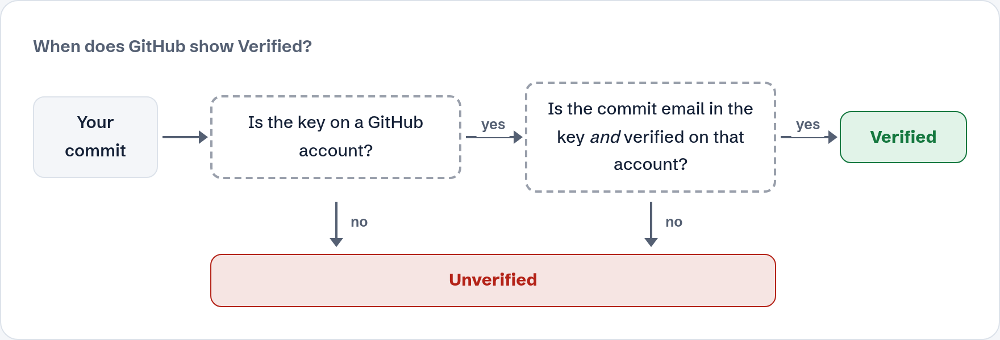
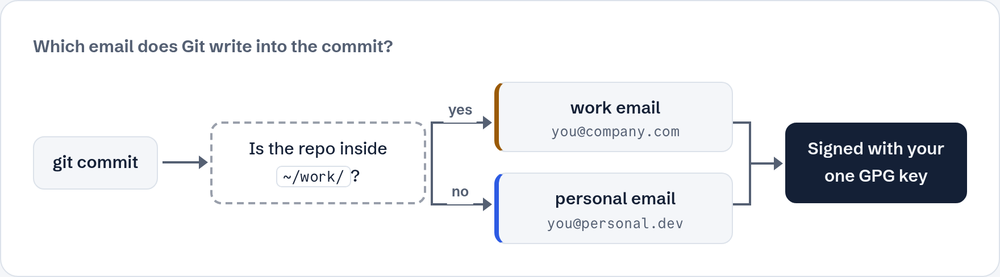
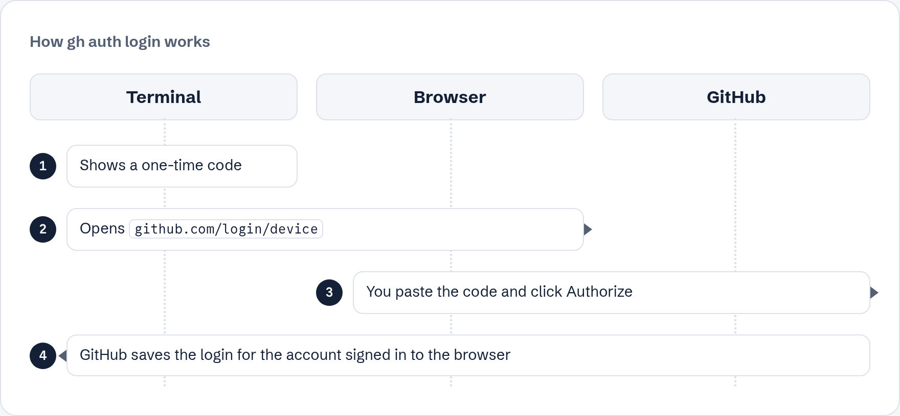

[Home](../README.md) · How it works (optional)

# How multiple accounts and Verified commits work

You don't need this page to follow the setup. It's here if you're curious.

## Three separate pieces

| Piece | Job | Stored in |
|---|---|---|
| gh login | Lets you push and pull | gh's keyring |
| Git email | Written into every commit | `~/.gitconfig` |
| GPG signature | Proves the commit is really yours | `~/.gnupg` |

Switching the gh account changes only the first piece. That's why the email and signature never get mixed up when you switch.

## When does GitHub say Verified?

<picture>
  <source media="(prefers-color-scheme: dark)" srcset="images/diagram-verified-dark.png">
  
</picture>

GitHub checks the signature against the keys on your accounts. The commit is **Verified** only when the key is on an account **and** the commit email is in the key **and** verified on that account. If any check fails, it shows **Unverified**.

## Which email does Git use?

<picture>
  <source media="(prefers-color-scheme: dark)" srcset="images/diagram-email-dark.png">
  
</picture>

Git reads `~/.gitconfig` first. If the repo is inside `~/work/`, the `includeIf` block loads `~/.gitconfig-work` and its email wins. Both emails live in the same key, so the signature matches either way.

## The login flow

<picture>
  <source media="(prefers-color-scheme: dark)" srcset="images/diagram-login-dark.png">
  
</picture>

The terminal shows a one-time code and opens `github.com/login/device`. You paste the code and authorize, and GitHub sends the login back to gh. That's why the browser must be signed in to the right account: GitHub approves the login for whoever is signed in **there**.

---

[Home](../README.md)
